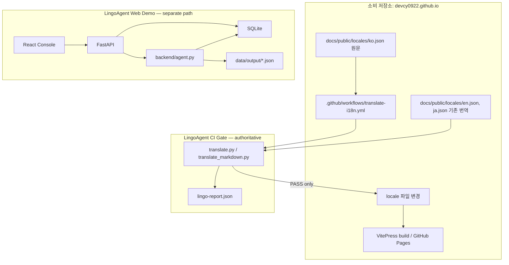
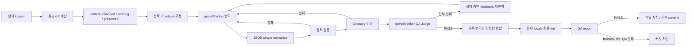

# LingoAgent Architecture

LingoAgent는 한국어 i18n 원문을 기준으로 변경된 번역 키를 생성하고, 구조 검증과 LLM 품질 검수를 통과한 경우에만 소비 저장소의 locale 파일을 갱신하는 번역 배포 게이트다.

이 레포에는 서로 다른 두 실행 경로가 있다. `translate.py`가 실제 CI/CD 배포 경로이며, `backend/`는 별도의 로컬 데모 경로다. 두 경로는 현재 동일한 오케스트레이터나 동일한 품질 보장을 공유하지 않는다.

## 1. 실행 경로의 경계



`translate.py`와 `translate_markdown.py`는 소비 저장소의 GitHub Actions에서 검증된 LingoAgent commit SHA로 checkout되어 실행된다. 이 경로가 자동 커밋의 유일한 승인 게이트다.

`backend/`는 작업 생성, 상태 polling, diff 확인, 수동 승인 UI를 보여주기 위한 데모다. 현재 구현은 CI 경로와 별개이며, 장애 시 fallback과 기본 QA 점수를 사용하므로 production 배포 게이트로 간주하면 안 된다.

## 2. CI 번역 처리 흐름



처리 계약은 다음과 같다.

1. 원문과 대상 언어 파일을 읽고 `--base-source`가 있으면 기준 원문과 비교한다.
2. 추가·변경·누락 키만 번역한다. 기존 번역은 보존하며 전체 재번역은 `--sync-all`에서만 허용한다.
3. 선택된 키만 원래의 중첩 JSON 구조로 모델에 전달한다.
4. 1차 테스트에서는 번역과 QA 모두 `govail/thinker`를 사용한다.
5. 평면 점 표기 키는 선택 범위가 정확히 일치할 때만 중첩 구조로 복원한다.
6. JSON, 키 일치, ICU 변수, glossary, 필수 번역·금지 표현을 결정적으로 검사한다.
7. QA는 생성된 모든 키를 batch로 검사하고, 실패 키만 feedback과 함께 재시도한다.
8. fallback, QA 장애, 구조 오류, 재시도 한도 초과는 커밋을 차단한다.
9. 통과한 결과만 기존 대상 언어 파일과 병합하고 report를 남긴다.

## 3. 상태와 불변조건

CI 성공 조건:

```text
success
= lint_passed
  && glossary_passed
  && qa_status == PASSED (또는 변경 키 없음)
  && is_fallback == false
```

- 대상 locale의 문자열 leaf key 집합은 원문과 동일하다.
- ICU 변수 집합은 원문과 번역문에서 동일하다.
- 변경되지 않은 기존 번역은 `--sync-all`이 아니면 덮어쓰지 않는다.
- QA를 받지 못한 결과는 성공으로 판정하지 않는다.
- fallback 결과는 성공이나 자동 커밋으로 전환되지 않는다.
- 부분 실패 시 통과 키는 고정하고 실패 키만 다시 번역한다.
- report가 성공을 증명하지 못하면 커밋하지 않는다.

## 4. 1차 통합 테스트: devcy0922.github.io

대상 경로는 `/srv/demo/devcy0922.github.io`다. 현재 대상 저장소에는 다음 workflow만 존재한다.

- `.github/workflows/ci.yml`: VitePress build 검증
- `.github/workflows/deploy.yml`: `main`의 GitHub Pages 배포

현재 locale 파일과 번역 workflow는 아직 없다. 따라서 첫 테스트는 기존 번역을 검증하는 테스트가 아니라 locale 계약을 추가하고 LingoAgent gate를 처음 연결하는 통합 테스트다.

1차 목표 계약:

```text
docs/public/locales/ko.json          source of truth
docs/public/locales/en.json          generated target
docs/public/locales/ja.json          generated target
docs/public/locales/ko.previous.json diff baseline
.github/workflows/translate-i18n.yml translation gate
lingo-report.json                    CI artifact
```

검증할 항목:

- `ko.json` 변경 시에만 번역 workflow가 실행되는가
- `en.json`과 `ja.json`이 같은 key structure를 유지하는가
- `govail/thinker` 호출 실패가 자동 커밋으로 이어지지 않는가
- 변경·누락 키만 번역되고 기존 번역이 보존되는가
- 성공·실패 양쪽에서 QA report가 남는가
- 통과 후에만 locale 변경이 `main`에 반영되고 Pages build가 실행되는가

소비 저장소 workflow는 checkout, 환경 준비, LingoAgent 실행, secret 주입, report artifact 보존, 성공 시 commit/PR, 실패 시 publish 차단만 담당한다. 번역 범위 계산과 품질 판정은 LingoAgent에 둔다.

Markdown 콘텐츠는 `translate_markdown.py`가 처리한다. 이 adapter는 frontmatter와 fenced code/Mermaid 블록을 원문 그대로 보존하고 나머지 Markdown segment만 `govail/thinker`에 전달한다. Gateway 오류나 빈 응답에는 fallback하지 않는다.

## 5. 웹 데모 경로의 현재 계약

```text
POST /api/jobs
  -> SQLite Job 생성
  -> FastAPI BackgroundTasks
  -> 언어별 LLM 번역
  -> 정적 lint
  -> LLM QA score
  -> Translation 저장
  -> REVIEW_READY / QA_FAILED / DEGRADED / FAILED
  -> POST /api/jobs/{id}/approve
  -> data/output/*.json 기록
```

이 경로는 현재 다음 이유로 CI gate와 동일한 보장으로 설명하면 안 된다.

- LLM 장애 시 local fallback을 표시하지만 승인 게이트를 통과시키지 않는다.
- QA 장애는 `qa_status=UNAVAILABLE` 및 `DEGRADED`로 표시하며 점수를 성공값으로 대체하지 않는다.
- `is_fallback`, `qa_status`, lint 결과와 점수 미달을 작업 상태에 반영한다.
- 재시작 resume, idempotency, lease/lock, cancellation이 없다.
- 승인 파일 출력이 원자적 publish가 아니며 rollback이 없다.
- 인증·인가 없이 승인 API가 노출되고 CORS가 전체 허용이다.

웹 데모의 사용자 계약은 다음과 같다.

1. 사용자는 한국어 원문 JSON과 대상 언어를 입력한다.
2. 시스템은 대상 언어별 번역 후보를 만들고, JSON 구조/변수 보존 lint와 품질 QA를 순서대로 수행한다.
3. 모든 대상 언어가 `lint=PASSED`, `qa_status=PASSED`, `quality_score>=85`, `is_fallback=false`일 때만 `REVIEW_READY`가 된다.
4. `REVIEW_READY`에서 승인하면 `data/output/ko-KR.json`과 대상 언어 JSON이 생성된다. 그 외 상태에서는 승인할 수 없다.

## 6. API와 저장 모델

| Method | Endpoint | 책임 |
|---|---|---|
| POST | `/api/jobs` | 원문 JSON과 대상 언어로 데모 작업 생성 |
| GET | `/api/jobs` | 작업 목록 조회 |
| GET | `/api/jobs/{job_id}` | 작업 및 언어별 결과 polling |
| POST | `/api/jobs/{job_id}/approve` | 데모 output 파일 기록 |
| DELETE | `/api/jobs/{job_id}` | 작업 및 번역 이력 삭제 |

- `jobs`: 원문, 대상 언어, 데모 작업 상태, 승인 메타데이터
- `translations`: 언어별 결과, lint/QA 상태, 점수, feedback, 시도 횟수

SQLite는 데모 영속성 저장소일 뿐 CI 배포 artifact의 source of truth가 아니다. CI의 source of truth는 소비 저장소의 Git 파일과 Git history다.

## 7. 모델 및 운영 설정

```text
LLM_TRANSLATION_MODEL=govail/thinker
LLM_REVIEW_MODEL=govail/thinker
LLM_GATEWAY_URL=<Gateway endpoint>
LLM_API_KEY=<CI secret>
LLM_TIMEOUT_SECONDS=240
```

모델은 번역 결과의 권위자가 아니다. 모델 출력은 구조·용어·품질 검증을 통과해야만 배포 후보가 된다.

## 8. 향후 hardening 범위

다음 항목은 현재 구현되었다고 주장하지 않는다.

- durable worker와 재시작 복구
- idempotency key 및 중복 실행 방지
- atomic artifact publish
- 인증·인가 및 승인자 권한 모델
- target language allowlist와 path safety
- schema migration
- 구조화된 metrics, tracing, alerting
