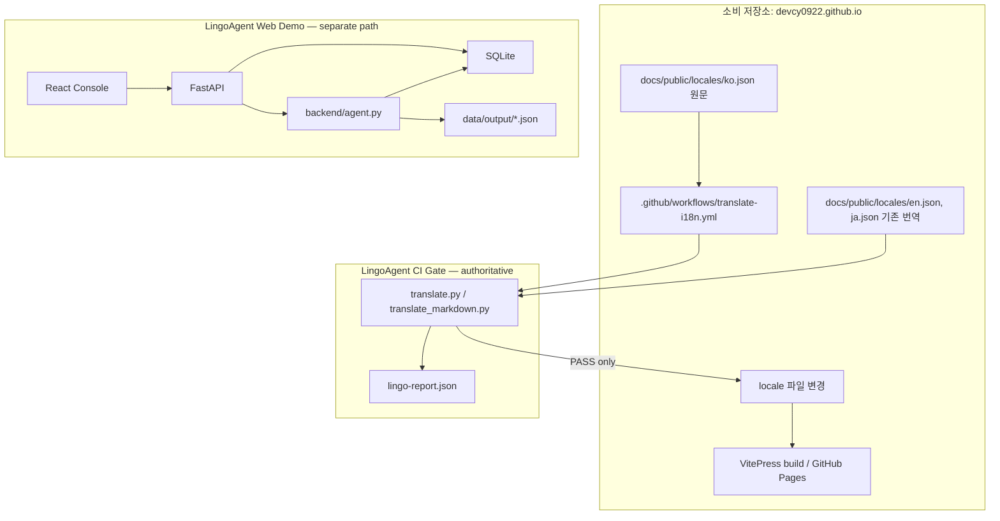
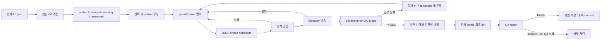
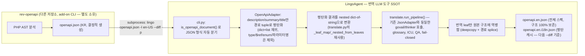
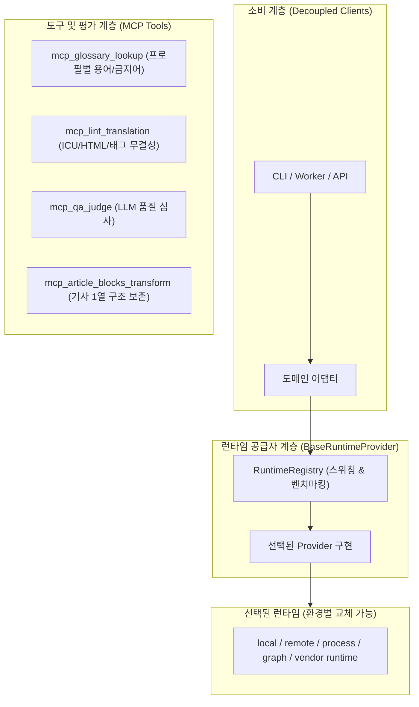

# LingoAgent Architecture

LingoAgent는 한국어 i18n 원문을 기준으로 변경된 번역 키를 생성하고, 구조 검증과 LLM 품질 검수를 통과한 경우에만 소비 저장소의 locale 파일을 갱신하는 번역 배포 게이트다.

이 레포에는 서로 다른 두 실행 경로가 있다. `translate.py`가 실제 CI/CD 배포 경로이며, `backend/`는 별도의 로컬 데모 경로다. 두 경로는 현재 동일한 오케스트레이터나 동일한 품질 보장을 공유하지 않는다.

## 1. 실행 경로의 경계



`lingo` 통합 CLI(및 호환 스크립트 `translate.py`, `translate_markdown.py`)는 소비 저장소의 개발자 로컬 환경 및 GitHub Actions에서 직접 호출된다. 계층형 프로필(`profiles/`)을 통해 프로젝트 성격(기술 블로그 vs 내부 관리자 콘솔 등)에 맞춘 톤앤매너와 용어집을 선언적으로 적용하며, 번역 메모리(TM)를 네임스페이스별로 격리한다.

`backend/` 및 `frontend/`는 중앙 번역 허브로서 작업 생성, 상태 모니터링, 직관적 Diff 비교 및 인간 승인(Human-in-the-loop)을 제공하는 웹 콘솔이다.

## 2. CI 번역 처리 흐름



처리 계약은 다음과 같다.

1. 원문과 대상 언어 파일을 읽고 `--base-source`가 있으면 기준 원문과 비교한다.
2. 추가·변경·누락 키만 번역한다. 기존 번역은 보존하며 전체 재번역은 `--sync-all`에서만 허용한다.
3. 선택된 키만 원래의 중첩 JSON 구조로 모델에 전달한다.
4. 1차 테스트에서는 번역과 QA 모두 `govail/thinker`를 사용한다.
5. 평면 점 표기 키는 선택 범위가 정확히 일치할 때만 중첩 구조로 복원한다.
6. JSON, 키 일치, ICU 변수, glossary, 필수 번역·금지 표현을 결정적으로 검사한다.
7. QA는 생성된 모든 키를 batch로 검사하고, 실패 키만 feedback과 함께 재시도한다.
8. fallback, QA 장애, 구조 오류, 재시도 한도 초과는 커밋을 차단한다.
9. 통과한 결과만 기존 대상 언어 파일과 병합하고 report를 남긴다.

## 3. 상태와 불변조건

CI 성공 조건:

```text
success
= lint_passed
  && glossary_passed
  && qa_status == PASSED (또는 변경 키 없음)
  && is_fallback == false
```

- 대상 locale의 문자열 leaf key 집합은 원문과 동일하다.
- ICU 변수 집합은 원문과 번역문에서 동일하다.
- 변경되지 않은 기존 번역은 `--sync-all`이 아니면 덮어쓰지 않는다.
- QA를 받지 못한 결과는 성공으로 판정하지 않는다.
- fallback 결과는 성공이나 자동 커밋으로 전환되지 않는다.
- 부분 실패 시 통과 키는 고정하고 실패 키만 다시 번역한다.
- report가 성공을 증명하지 못하면 커밋하지 않는다.

## 4. 1차 통합 테스트: devcy0922.github.io

대상 경로는 `/srv/demo/devcy0922.github.io`다. 현재 대상 저장소에는 다음 workflow만 존재한다.

- `.github/workflows/ci.yml`: VitePress build 검증
- `.github/workflows/deploy.yml`: `main`의 GitHub Pages 배포

현재 locale 파일과 번역 workflow는 아직 없다. 따라서 첫 테스트는 기존 번역을 검증하는 테스트가 아니라 locale 계약을 추가하고 LingoAgent gate를 처음 연결하는 통합 테스트다.

1차 목표 계약:

```text
docs/public/locales/ko.json          source of truth
docs/public/locales/en.json          generated target
docs/public/locales/ja.json          generated target
docs/public/locales/ko.previous.json diff baseline
.github/workflows/translate-i18n.yml translation gate
lingo-report.json                    CI artifact
```

검증할 항목:

- `ko.json` 변경 시에만 번역 workflow가 실행되는가
- `en.json`과 `ja.json`이 같은 key structure를 유지하는가
- `govail/thinker` 호출 실패가 자동 커밋으로 이어지지 않는가
- 변경·누락 키만 번역되고 기존 번역이 보존되는가
- 성공·실패 양쪽에서 QA report가 남는가
- 통과 후에만 locale 변경이 `main`에 반영되고 Pages build가 실행되는가

소비 저장소 workflow는 checkout, 환경 준비, LingoAgent 실행, secret 주입, report artifact 보존, 성공 시 commit/PR, 실패 시 publish 차단만 담당한다. 번역 범위 계산과 품질 판정은 LingoAgent에 둔다.

Markdown 콘텐츠는 `translate_markdown.py`가 처리한다. 이 adapter는 frontmatter와 fenced code/Mermaid 블록을 원문 그대로 보존하고 나머지 Markdown segment만 `govail/thinker`에 전달한다. Gateway 오류나 빈 응답에는 fallback하지 않는다.

## 5. 웹 데모 경로의 현재 계약

```text
POST /api/jobs
  -> SQLite Job 생성
  -> FastAPI BackgroundTasks
  -> 언어별 LLM 번역
  -> 정적 lint
  -> LLM QA score
  -> Translation 저장
  -> REVIEW_READY / QA_FAILED / DEGRADED / FAILED
  -> POST /api/jobs/{id}/approve
  -> data/output/*.json 기록
```

이 경로는 현재 다음 이유로 CI gate와 동일한 보장으로 설명하면 안 된다.

- LLM 장애 시 local fallback을 표시하지만 승인 게이트를 통과시키지 않는다.
- QA 장애는 `qa_status=UNAVAILABLE` 및 `DEGRADED`로 표시하며 점수를 성공값으로 대체하지 않는다.
- `is_fallback`, `qa_status`, lint 결과와 점수 미달을 작업 상태에 반영한다.
- 재시작 resume, idempotency, lease/lock, cancellation이 없다.
- 승인 파일 출력이 원자적 publish가 아니며 rollback이 없다.
- 인증·인가 없이 승인 API가 노출되고 CORS가 전체 허용이다.

웹 데모의 사용자 계약은 다음과 같다.

1. 사용자는 한국어 원문 JSON과 대상 언어를 입력한다.
2. 시스템은 대상 언어별 번역 후보를 만들고, JSON 구조/변수 보존 lint와 품질 QA를 순서대로 수행한다.
3. 모든 대상 언어가 `lint=PASSED`, `qa_status=PASSED`, `quality_score>=85`, `is_fallback=false`일 때만 `REVIEW_READY`가 된다.
4. `REVIEW_READY`에서 승인하면 `data/output/ko-KR.json`과 대상 언어 JSON이 생성된다. 그 외 상태에서는 승인할 수 없다.

## 6. API와 저장 모델

| Method | Endpoint | 책임 |
|---|---|---|
| POST | `/api/jobs` | 원문 JSON과 대상 언어로 데모 작업 생성 |
| GET | `/api/jobs` | 작업 목록 조회 |
| GET | `/api/jobs/{job_id}` | 작업 및 언어별 결과 polling |
| POST | `/api/jobs/{job_id}/approve` | 데모 output 파일 기록 |
| DELETE | `/api/jobs/{job_id}` | 작업 및 번역 이력 삭제 |

- `jobs`: 원문, 대상 언어, 데모 작업 상태, 승인 메타데이터
- `translations`: 언어별 결과, lint/QA 상태, 점수, feedback, 시도 횟수

SQLite는 데모 영속성 저장소일 뿐 CI 배포 artifact의 source of truth가 아니다. CI의 source of truth는 소비 저장소의 Git 파일과 Git history다.

## 7. 모델 및 운영 설정

```text
LLM_TRANSLATION_MODEL=govail/thinker
LLM_REVIEW_MODEL=govail/thinker
LLM_GATEWAY_URL=<Gateway endpoint>
LLM_API_KEY=<CI secret>
LLM_TIMEOUT_SECONDS=240
```

모델은 번역 결과의 권위자가 아니다. 모델 출력은 구조·용어·품질 검증을 통과해야만 배포 후보가 된다.

## 8. OpenAPI 어댑터와 소비 저장소 통합 (`rev-openapi`)

`lingo` CLI는 OpenAPI 3.x 스펙(`openapi.json`)도 `.json` 확장자로 들어오지만, 일반 i18n locale JSON과 달리 `type`, `format`, `$ref`, enum 값, 파라미터/스키마 이름 같은 구조적 문자열이 섞여 있다. 이를 그대로 `JsonAdapter`(leaf 전체 번역)에 넣으면 스펙이 깨진다. 그래서 `OpenApiAdapter`가 별도로 존재하며, `description`/`summary`/`title` 키의 문자열만 번역 대상으로 선별한다.



계약:

1. `rev-openapi`는 이 레포와 무관한 별도 저장소이며, `openapi.json` 생성(P1, AST/diff-patch)만 책임진다. 번역 LLM 도구는 만들지 않고 `lingo`를 서브프로세스로 호출한다.
2. LLM 백엔드는 계속 `govail/thinker`다(§7 모델 설정 변경 없음). `OpenApiAdapter`는 새 LLM 클라이언트를 만들지 않고 `translate.run_pipeline`에 위임한다.
3. `description`/`summary`/`title` 키 이름 기준으로만 번역 대상을 선별한다. 이 필터를 벗어난 값(`type`, `format`, `$ref`, `enum`, `operationId`, 파라미터/프로퍼티 이름 등)은 항상 원문 그대로 보존된다.
4. 리스트(parameters, tags, examples 등)도 경로에 인덱스를 포함해 순회한다 — `translate.py`의 `_leaf_map`은 dict만 순회하므로, 어댑터가 리스트를 문자열 인덱스로 평탄화한 뒤에만 기존 파이프라인에 넘긴다.
5. 평탄화된 결과(캐시 파일 `*.{lang}.i18n.json`)가 다음 `--diff` 실행의 기준(existing/base)이 되어, 변경되지 않은 설명은 재번역하지 않는다 — `rev-openapi`의 "변경분만 patch" 철학과 동일한 증분 원칙을 번역 계층에도 유지한다.
6. `rev-openapi` 쪽 실제 훅 연결(`sync` 이후 `lingo` 서브프로세스 호출)은 `rev-openapi`가 P1(CLI) 구현을 마친 뒤 그 저장소에서 진행한다 — 이 레포는 호출 가능한 CLI 계약만 제공한다.

## 9. 향후 hardening 범위

다음 항목은 점진적으로 고도화 중이다:

- durable worker와 재시작 복구 (LangGraph Checkpointer 기반 부분 완료)
- idempotency key 및 중복 실행 방지
- atomic artifact publish
- 인증·인가 및 승인자 권한 모델
- target language allowlist와 path safety
- schema migration
- 구조화된 metrics, tracing, alerting (RuntimeMetrics 및 RuntimeEvent 도입)

## 10. 다국어 런타임 추상화 및 벤치마킹 아키텍처

Lingo는 특정 워크플로 프레임워크나 내부 런타임에 강결합되지 않도록 **공급자 추상화 계층(Runtime Provider Pattern)**과 **표준 도구 계층(MCP)**으로 분리되어 있다. 핵심 경계는 `RuntimeRegistry → Provider → Runtime`이며, LangGraph·engine-process·그 밖의 런타임은 선택 가능한 Provider 구현이다. LangGraph StateGraph와 LangGraph Provider의 실제 구현은 독립 저장소 [`langgraph-process`](https://github.com/devcy0922/langgraph-process)가 소유하고, 이 저장소에는 호환 facade만 둔다. 따라서 engine-process만 가능한 환경에서도 다른 런타임의 설치를 요구하지 않는다.



### A. LangGraph 상태 머신 (Cyclic StateGraph, `langgraph-process` 소유)
- **노드**: `prepare` → `draft_translate` → `lint` → `qa_judge` → `assemble`
- **조건부 피드백 엣지 (`should_retry_or_assemble`)**:
  - 린트 또는 QA 점수 미달 아이템이 존재할 경우, 피드백(`critique`, `lint_errors`)을 프롬프트에 주입하여 `draft_translate`로 루프백.
  - 최대 재시도 한도(`max_retries`) 도달 시 또는 전원 합격 시 `assemble`로 전이.
- **체크포인팅**: `MemorySaver`를 통해 임의의 `thread_id`(`task_id`)별 실행 상태 스냅샷 저장 및 재개 지원.

### B. 런타임 관측성 및 벤치마킹 (`RuntimeRegistry.benchmark_runtimes`)
- **이벤트 방출 (`RuntimeEvent`)**: `init`, `dispatch`, `draft_translate`, `lint`, `qa_judge`, `assemble`, `completed`, `error` 등 노드 단위 실시간 스트리밍.
- **메트릭 (`RuntimeMetrics`)**: 전체 소요 시간(`total_duration_ms`), 단계별 지연(`stage_durations_ms`), 재시도 횟수, QA 평균 점수 기록.
- **벤치마크**: 동일한 `TranslationTask`에 대해 현재 환경에 등록된 Provider 목록을 명시해 성능/비용/품질 비교 리포트 생성. `langgraph`와 `engine-process` 동시 실행은 두 Provider가 실제 설치·등록된 환경에서만 수행.

### C. Newsroom 기사 블록 보존 (`NewsroomArticleAdapter`)
- 뉴스룸의 에디토리얼 1열 본문(`headline`, `dek`, `body: ArticleBlock[]`, `keynumbers`) 구조를 손상 없이 분해·재조립.
- 번역 완료 시 `lang`, `parent_article_id`, `tags: ['lang:en']` 속성을 부여하여 즉시 발행 가능한 다국어 기사 객체로 포맷팅.

## 11. Provider 호출 경계와 현재 미연결 지점

Provider API의 실제 계약은 다음과 같다.

```text
Consumer → RuntimeRegistry.get_provider(name)
         → BaseRuntimeProvider.execute(task)
         → 선택된 Runtime Provider
         → 선택된 Runtime
```

`EngineProcessRuntimeProvider`가 선택된 구성에서만 해당 Provider가 engine-process `/v1/process/jobs` 호출을 소유한다. 따라서 소비자와 engine-process 사이에는 Provider 경계가 있지만, Provider 자체가 upstream engine-process로 직접 HTTP 요청하는 것은 의도된 어댑터 동작이다. Registry는 concrete Provider를 지연 import하므로 engine-process-only 환경이 LangGraph import에 실패하지 않는다. LangGraph가 선택되면 `langgraph-process`의 Provider facade를 통해 외부 구현을 사용한다.

현재 `lingo` CLI의 JSON/Markdown 경로는 이 계약을 아직 사용하지 않는다. `cli.py`의 `--runtime`은 환경변수만 설정하고, `JsonAdapter`·`MarkdownAdapter`·`OpenApiAdapter`는 레거시 `translate.run_pipeline()`을 호출한다. Provider 직접 테스트가 통과했다는 사실을 CLI Provider 통합 또는 실제 engine-process 호출 증거로 확대 해석하지 않는다.
